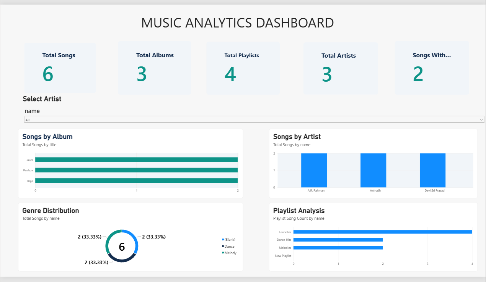

# Music Player Analytics Dashboard

An interactive music analytics dashboard developed using PostgreSQL, SQL, Power BI, and DAX to manage and analyze music-related data.

## Project Overview

This project demonstrates the integration of relational database management and interactive data visualization. It was developed as an extension of my SQL and Database Management Systems internship project at EduSkills Academy.

## Dashboard Preview

## Technology Stack

- PostgreSQL - Relational database management
- SQL - Data retrieval and analysis
- Power BI Desktop - Interactive visualization
- DAX - KPI calculations
- Visual Studio Code - SQL development

## Project Features

- Relational database with six interconnected tables
- Five dynamic KPI cards
- Album-wise song analysis
- Artist-wise song analysis
- Genre distribution analysis
- Playlist analysis
- Interactive artist filtering
- Identification of songs without assigned genres

## System Architecture

PostgreSQL Database → SQL Data Analysis → Power BI Data Modeling → DAX Measures → Interactive Dashboard

## Database Tables

- Artists
- Albums
- Songs
- Genres
- Playlists
- Playlist_Songs

## Project Results

| Metric | Value |
|---|---:|
| Total Songs | 6 |
| Total Artists | 3 |
| Total Albums | 3 |
| Total Playlists | 4 |
| Songs Without Genre | 2 |

## Repository Structure

- `01_create_tables.sql` - Database schema creation
- `02_insert_data.sql` - Sample data insertion
- `03_queries.sql` - Analytical SQL queries
- `Music_Analytics_Dashboard.pbix` - Power BI report
- `Dashboard.png` - Dashboard preview
- `README.md` - Project documentation

## How to Run

1. Install PostgreSQL and Power BI Desktop.
2. Create a database named `music_player`.
3. Execute `01_create_tables.sql`.
4. Execute `02_insert_data.sql`.
5. Execute `03_queries.sql` to analyze the data.
6. Open the Power BI (.pbix) file.
7. Configure your local PostgreSQL connection and refresh the data if required.

## Future Enhancements

- Larger music datasets
- Personalized music recommendations
- Listening history analysis
- Advanced database optimization
- Cloud database integration

## Limitations

This project is an educational prototype using sample music data. It does not provide audio playback or music streaming functionality.

## Author

**Dornipadu Lakshmi Sreekanth**

B.Tech - Computer Science and Engineering (AI & ML)

Mohan Babu University

Developed as part of SQL and DBMS internship learning and subsequent dashboard enhancement.
